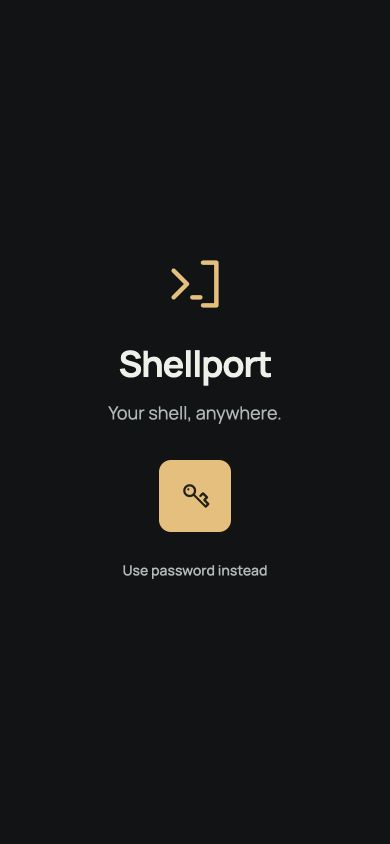
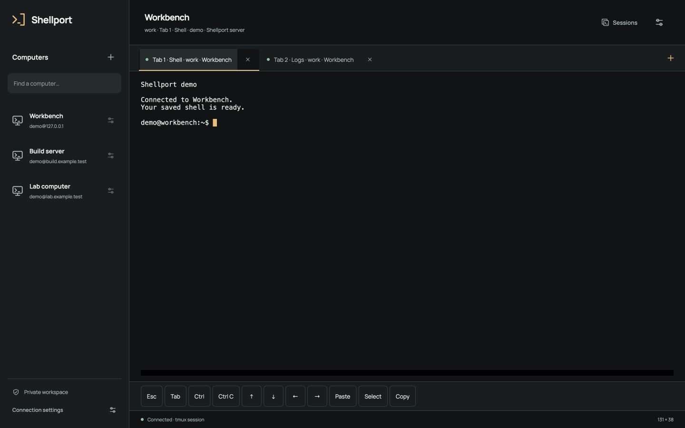
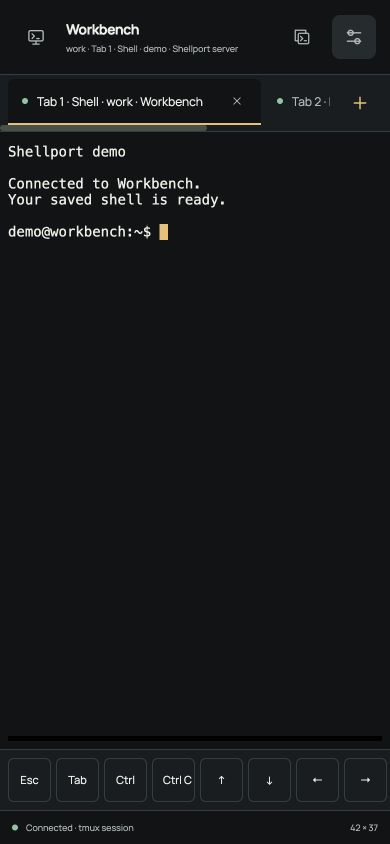
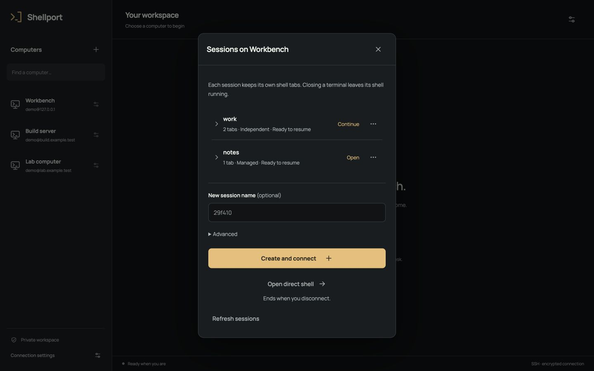
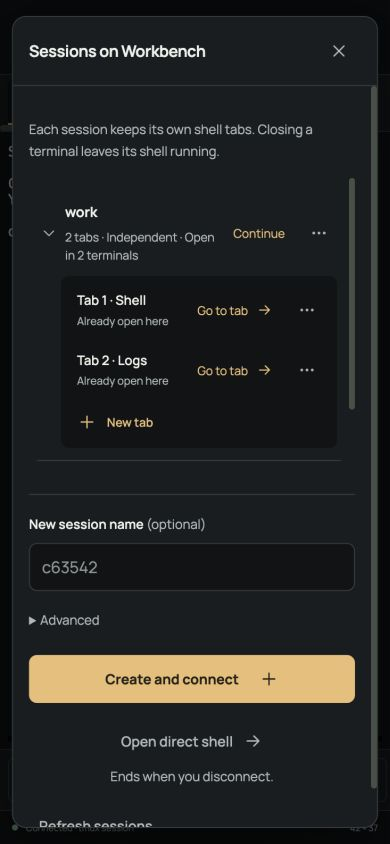
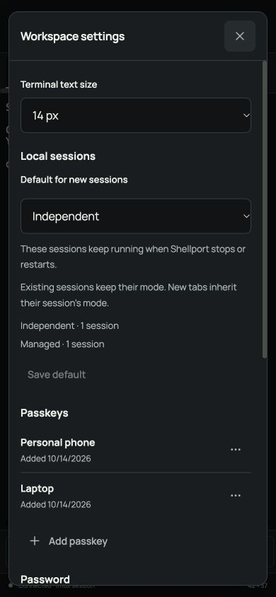
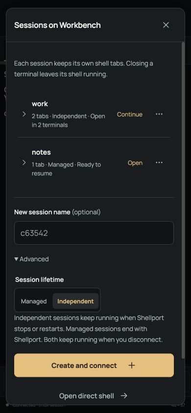
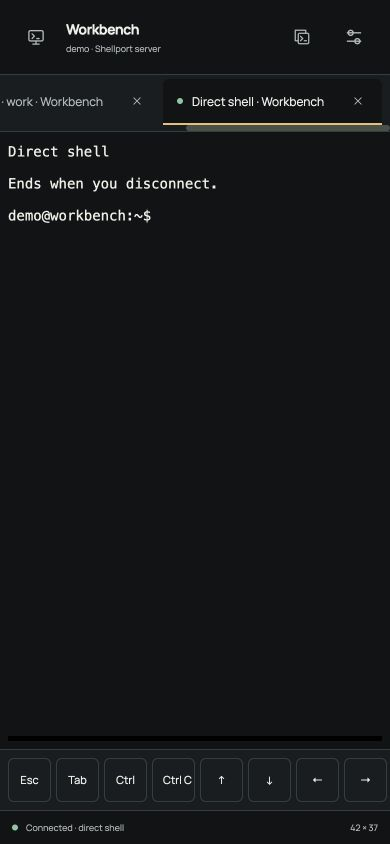
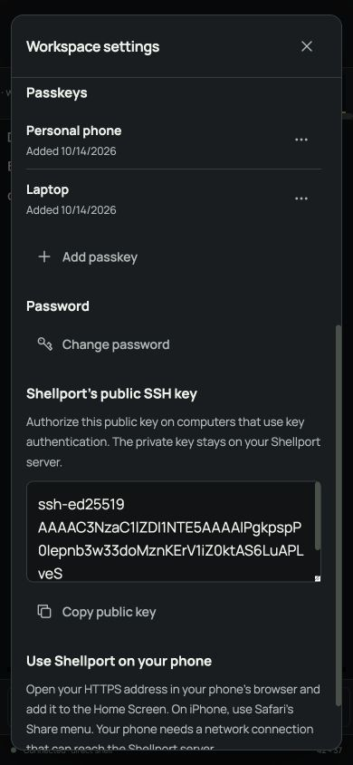

# Shellport in pictures

These are captures of the real web interface using demonstration computers, synthetic passkeys and disposable tmux sessions. Phone images show a browser viewport; the native keyboard and device passkey prompts belong to your phone and are not pictured.

## Sign in

Use a passkey, or reveal the password field when you need it.

## On your computer

Saved computers, independent terminal tabs and keyboard controls share one workspace.

## On your phone

The same terminal uses compact navigation and a row of keyboard controls.

## Sessions and tabs

Expand a saved session to resume one of its shell tabs or open a new one. Each session and tab has its own options menu.

## Session lifetime

Independent sessions keep running when Shellport stops or restarts; managed sessions end with it. Both keep running when you disconnect. Settings chooses the default for new sessions. When both modes are enabled, Advanced lets you choose a different lifetime for a new session.

 

## Direct shells

Open a normal shell from the same computer's session picker. A direct shell ends when you disconnect.

## Passkeys and password

Add, rename or remove passkeys, and change your app password from settings.

